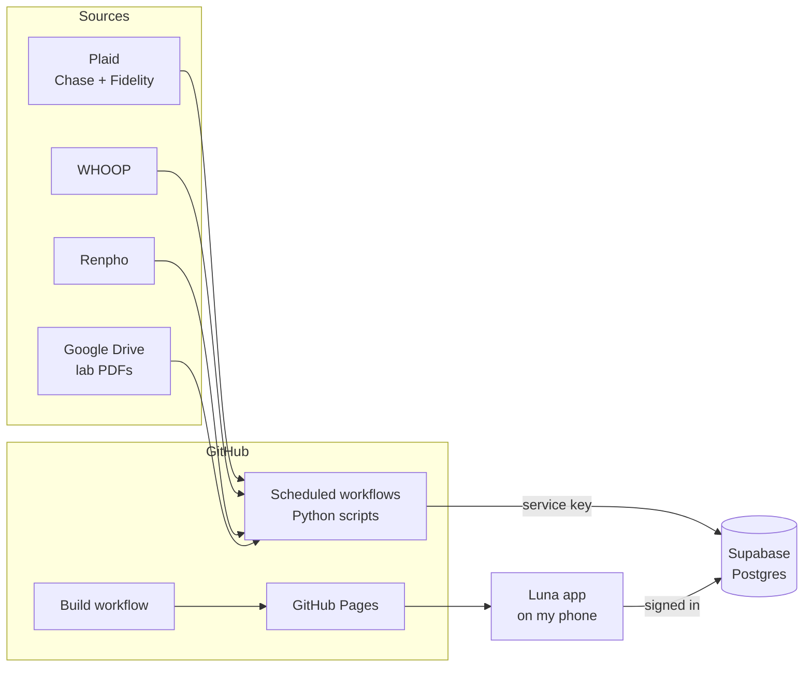

# Luna

A personal dashboard that lives on my phone. My spending, investments, sleep, workouts, weight and lab results, all in one app and updated automatically every day.

**App:** https://fernandomartinez-de.github.io/personal/luna/ (requires my sign in)

---

## What it does

| Area | Where the data comes from | How often | Where it shows up in Luna |
|------|---------------------------|-----------|---------------------------|
| **Spending** | Chase checking and credit cards (through Plaid) | Daily | Finances → Expenses, money alerts |
| **Investments** | Fidelity retirement and brokerage (through Plaid), live stock and crypto prices | Weekdays | Finances → Investments, Hub |
| **Home value** | Zillow and Redfin estimates | Monthly, by hand | Finances → Investments |
| **Recovery, sleep, strain** | WHOOP band | 5 times a day | Hub, Fitness, Workouts, Food |
| **Weight and body fat** | Renpho smart scale | Daily | Weight, Fitness, Workouts |
| **Lab results** | PDFs I drop into a Google Drive folder | Daily | Medical, Hub |
| **Workouts and meals** | Logged by me in the app | When I log them | Workouts, Food |

---

## How it works



1. **Scheduled workflows** (GitHub Actions) wake up on a timer, pull new data from each service, and save it to the database.
2. **Supabase** stores everything in one Postgres database.
3. **Luna** is a React app hosted for free on GitHub Pages. It installs on the phone's home screen and reads from the database after I sign in.

No servers to run and nothing to pay for beyond the services themselves.

---

## Documentation

| I want to... | Read |
|--------------|------|
| Build my own copy of this | [docs/setup.md](docs/setup.md) |
| Run it day to day, fix something, or add a feature | [docs/operations.md](docs/operations.md) |
| Know what's in the database | [docs/tables.md](docs/tables.md) |
| Work on the app | [luna/README.md](luna/README.md) |
| Understand the money syncs | [finances/README.md](finances/README.md) |
| Understand the health syncs | [health/README.md](health/README.md) |

---

## Repo layout

```
personal/
├── luna/           The app. Source code in luna/app/, the built site next to it.
├── finances/       Scripts that pull bank, investment and home value data.
├── health/         Scripts that pull WHOOP, Renpho and lab result data.
├── supabase/       schema.sql: recreates the whole database in one step.
├── docs/           Setup guide, operations guide, database reference.
├── .github/        The scheduled and build workflows.
├── index.html      Sends visitors from /personal/ to the app.
└── 404.html        Lets links deep inside the app work on GitHub Pages.
```

---

## Security

The repo is public, so everything here is designed to be safe to read:

- **No passwords or keys in the code.** They live in GitHub Secrets and local `.env` files that are never committed.
- **The app requires a real sign in.** Supabase emails a one time code to my address. The 4 digit code on open is only a quick lock screen.
- **The database only answers my account.** Every table allows reads and writes only for my signed in email. The public key built into the app gets nothing on its own. The sync workflows use a private service key kept in GitHub Secrets.
- **No personal notes here.** My notes live in a separate private repo; nothing personal beyond the app's code is published.
